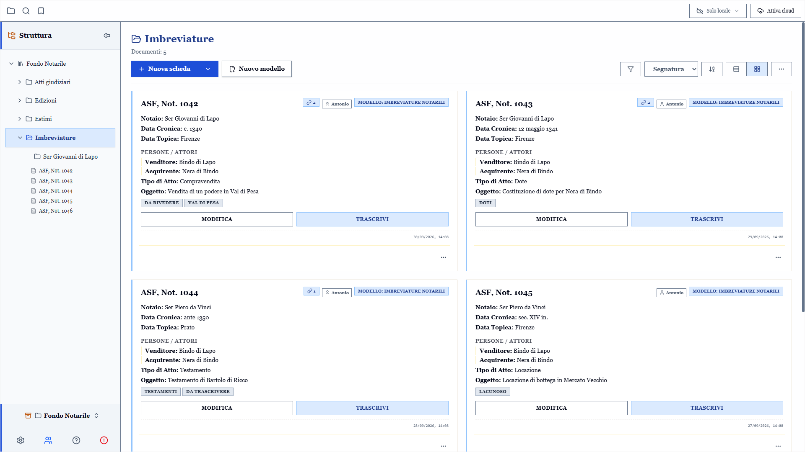
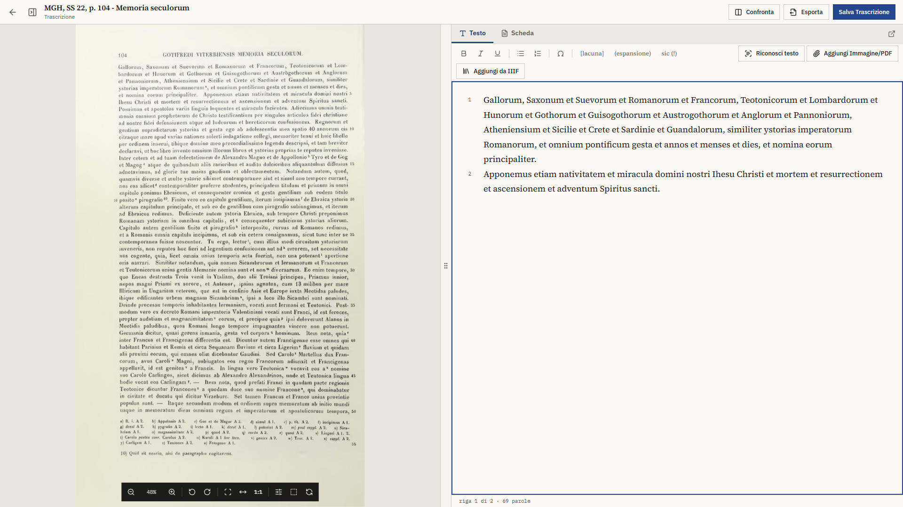
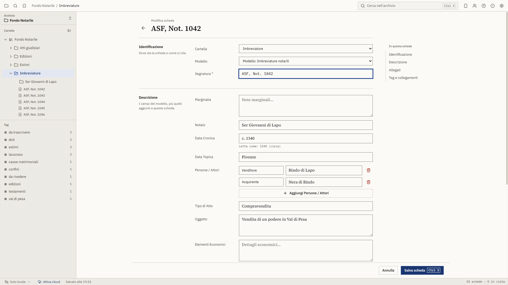
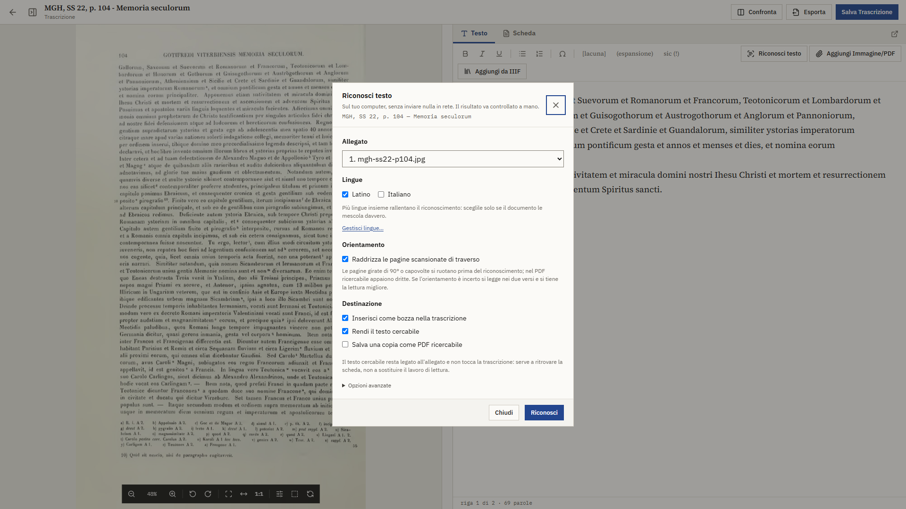
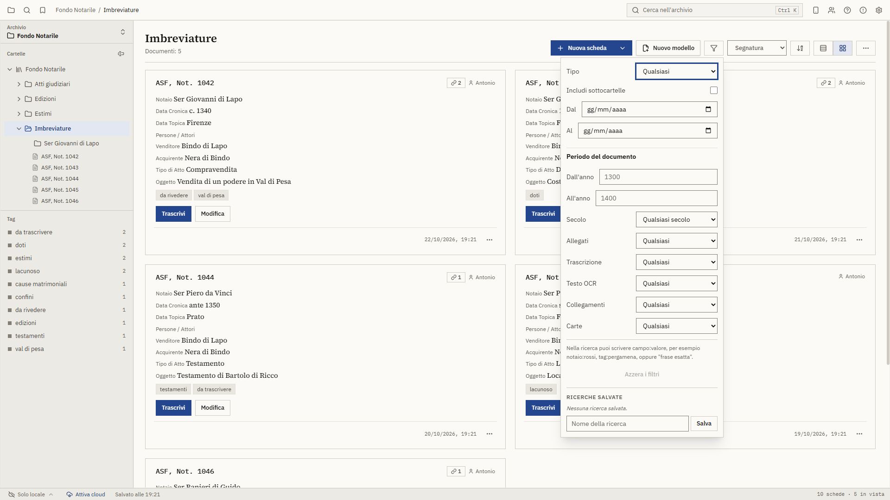
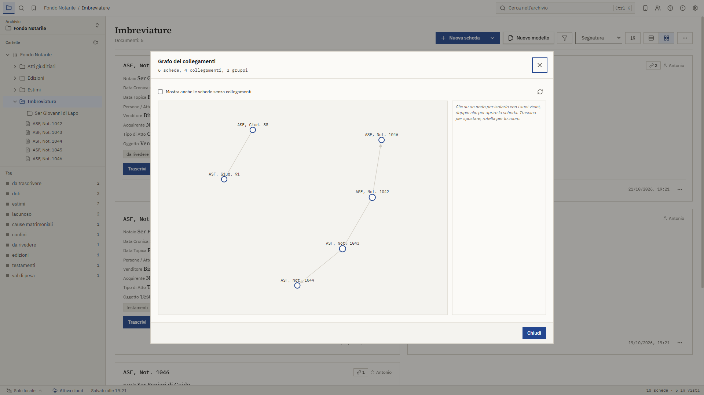
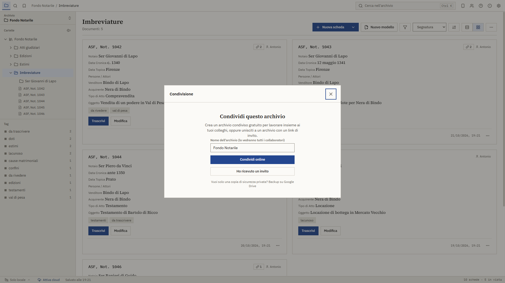
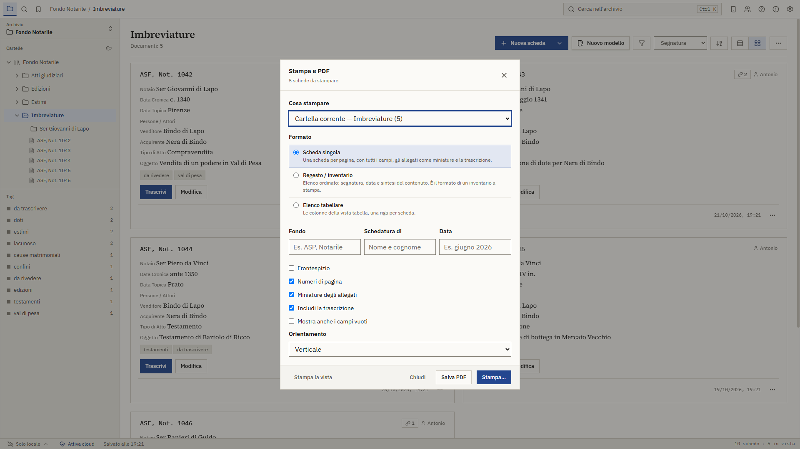

*Leggi in [Inglese](README.md)*

<picture>
  <source media="(prefers-color-scheme: dark)" srcset="docs/screenshots/it/vista-griglia-dark.png">
  
</picture>

# ArchiView

[](https://github.com/AntonioOrf/ArchiView/releases/latest)
[](https://github.com/AntonioOrf/ArchiView/releases?q=scanner-v&expanded=true)

**ArchiView** è un'applicazione desktop (creata con Electron) per catalogare, archiviare e trascrivere manoscritti e documenti storici. Funziona offline.

## Trascrizione

<picture>
  <source media="(prefers-color-scheme: dark)" srcset="docs/screenshots/it/trascrizione-dark.png">
  
</picture>

L'editor della trascrizione sta accanto alle immagini o al PDF del documento, con una trascrizione per ogni carta o pagina di PDF.

## Modelli di documento

<picture>
  <source media="(prefers-color-scheme: dark)" srcset="docs/screenshots/it/form-scheda-dark.png">
  
</picture>

Ogni scheda segue un modello di documento, che decide quali campi compaiono nel modulo. ArchiView ne include tre (Imbreviature notarili, Atti giudiziari, Documenti fiscali) e puoi costruirne di tuoi con i campi che ti servono (titolo, autori, segnatura, supporto e così via). Una singola scheda può anche avere campi propri che il suo modello non prevede.

## Riconoscimento del testo (OCR)

<picture>
  <source media="(prefers-color-scheme: dark)" srcset="docs/screenshots/it/ocr-dark.png">
  
</picture>

Riconosci il testo di scansioni e PDF interamente offline, con i pacchetti di lingua da installare solo quando servono. Il risultato può entrare nella trascrizione come bozza, oppure restare legato all'allegato come testo cercabile, per ritrovare la scheda. Il riconoscimento può anche salvare una copia dell'allegato come **PDF ricercabile**, e le pagine scansionate di traverso o capovolte vengono raddrizzate da sole.

## Ricerca, filtri e tag

<picture>
  <source media="(prefers-color-scheme: dark)" srcset="docs/screenshots/it/filtri-dark.png">
  
</picture>

Filtra l'archivio per tipo di documento, intervallo di date storiche o secolo, e secondo la presenza di allegati, trascrizione, testo OCR o collegamenti. La casella di ricerca accetta interrogazioni `campo:valore` (per esempio `notaio:rossi`, `tag:pergamena`) e frasi esatte, e le ricerche si possono salvare. I tag hanno un pannello proprio nella barra laterale, con il conteggio delle schede.

## Collegamenti e grafo

<picture>
  <source media="(prefers-color-scheme: dark)" srcset="docs/screenshots/it/grafo-dark.png">
  
</picture>

Collega le schede fra loro con collegamenti tipizzati (atto collegato, copia di, e così via). Ogni scheda mostra le schede a cui rimanda e quelle che la citano. Il grafo dei collegamenti dà una vista d'insieme dell'archivio: un clic su un nodo lo isola con i suoi vicini, un doppio clic apre la scheda.

## Archivi condivisi

<picture>
  <source media="(prefers-color-scheme: dark)" srcset="docs/screenshots/it/condivisione-dark.png">
  
</picture>

Crea gratuitamente un archivio condiviso e invita i colleghi con un link. Schede, trascrizioni e nome dell'archivio vengono cifrati prima di lasciare il computer, così il server non può leggerli. Quando qualcuno invia modifiche, gli altri membri ne sono avvisati subito. Se due persone cambiano lo stesso campo, ArchiView mostra le due versioni e ti fa scegliere; le modifiche a campi diversi si uniscono da sole. Se ti serve solo una copia privata, puoi invece fare il backup su Google Drive.

## Stampa ed esportazione

<picture>
  <source media="(prefers-color-scheme: dark)" srcset="docs/screenshots/it/stampa-dark.png">
  
</picture>

Stampa una scheda, una cartella o l'intero archivio, o salvali in PDF, in tre formati: scheda singola con miniature e trascrizione, regesto/inventario come un inventario a stampa, oppure elenco tabellare, con frontespizio facoltativo. Le trascrizioni si esportano in HTML, Markdown o RTF (per Word e LibreOffice), le citazioni in BibTeX per LaTeX, Zotero e JabRef.

## Altre funzioni

- Importa manoscritti digitalizzati da qualunque biblioteca pubblichi manifest IIIF (Presentation v2 e v3), come BnF/Gallica, e-codices, la Biblioteca Apostolica Vaticana, la British Library e la Bodleian. Le carte arrivano dalla biblioteca e restano in una cache locale; per l'OCR o il lavoro offline si possono scaricare nell'archivio.
- Organizza le schede in cartelle e sottocartelle, e tieni i progetti che non c'entrano fra loro in archivi separati.
- Allega scansioni, fotografie e PDF a una scheda e guardali dentro l'app, con zoom, rotazione, luminosità, contrasto e negativo.
- Impara l'app con la visita guidata integrata. L'interfaccia è in italiano e in inglese.
- I dati restano nella cartella di lavoro, in un file JSON più una cartella di allegati, leggibili anche fuori dall'app. Copiando quella cartella sposti o salvi l'intero archivio; l'app sa anche raccogliere archivio e allegati in un unico file ZIP.

## Download e installazione

Per ora ArchiView funziona solo su Windows.

1. Vai alla pagina [Releases](https://github.com/AntonioOrf/Schedatore/releases) del progetto su GitHub.
2. Scarica il file `.exe` dell'ultima versione.
3. Avvia il file scaricato.

## Guida utente (wiki)

La guida copre installazione, interfaccia, schede, trascrizione, ricerca, sincronizzazione e condivisione, esportazione e stampa, e ha una FAQ. Si legge nella **[Wiki di ArchiView](https://archiview.orfhist.com/wiki/)** (anche in [inglese](https://archiview.orfhist.com/wiki/en/)).

---

## Per gli sviluppatori (compilazione da sorgente)

Per avviare l'applicazione dal sorgente serve [Node.js](https://nodejs.org/):

1. Clona questo repository o estrai i file del progetto.
2. Apri il terminale nella directory principale (dove si trova il file `package.json`).
3. Installa le dipendenze:
   ```bash
   npm install
   ```
4. Avvia l'applicazione:
   ```bash
   npm start
   ```

### Creare l'installer

```bash
npm run pack
```

`electron-builder` scrive l'installer per Windows nella cartella `dist`.

## Primo avvio

Al primo avvio ArchiView chiede di scegliere una **cartella di lavoro**. Scegline una vuota, in un posto dove non rischi di cancellarla per errore. Al suo interno l'app crea:

- `database_manoscritti.json`, con tutte le schede, le trascrizioni e i metadati;
- `allegati_manoscritti`, dove vengono copiate le immagini e i PDF che alleghi.

Puoi cambiare la cartella di lavoro in seguito dalle **Impostazioni**.

## Tecnologie utilizzate

- [Electron](https://www.electronjs.org/) per il framework desktop.
- [Tailwind CSS](https://tailwindcss.com/) per lo styling dell'interfaccia.
- [Lucide Icons](https://lucide.dev/) per le icone.

## Privacy e termini di servizio

- [Privacy Policy](PRIVACY_POLICY.md)
- [Terms of Service](TERMS_OF_SERVICE.md)

## Licenza

Consulta il file [LICENSE](LICENSE) per ulteriori informazioni sulle condizioni d'uso.
