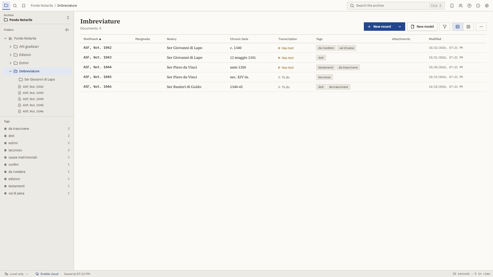
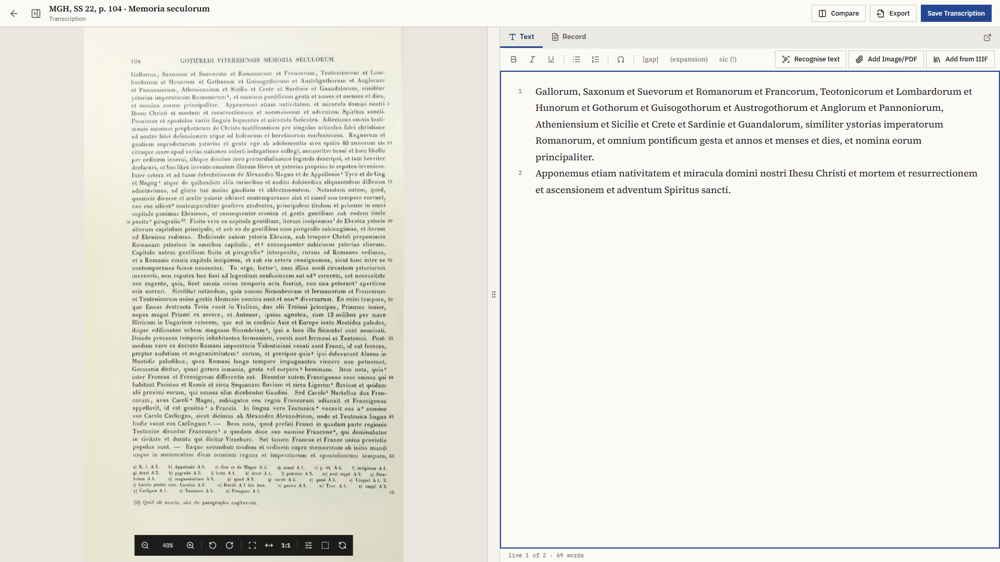
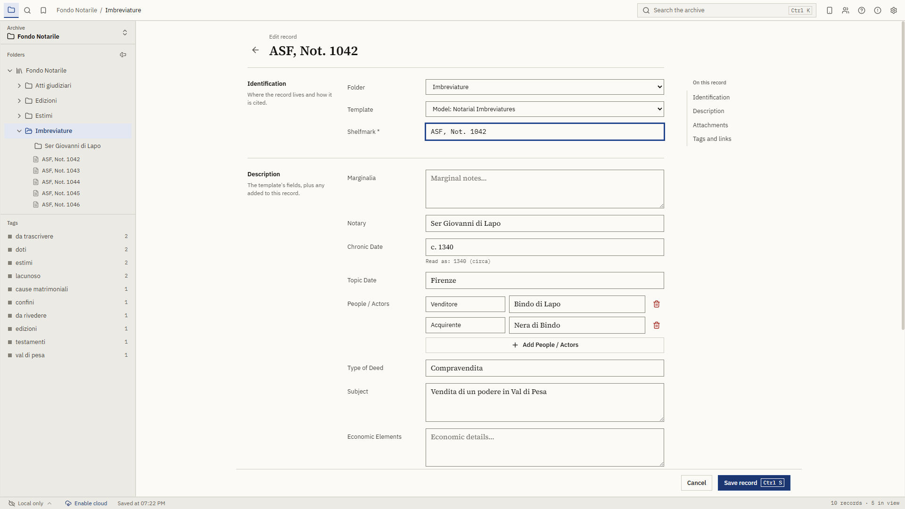
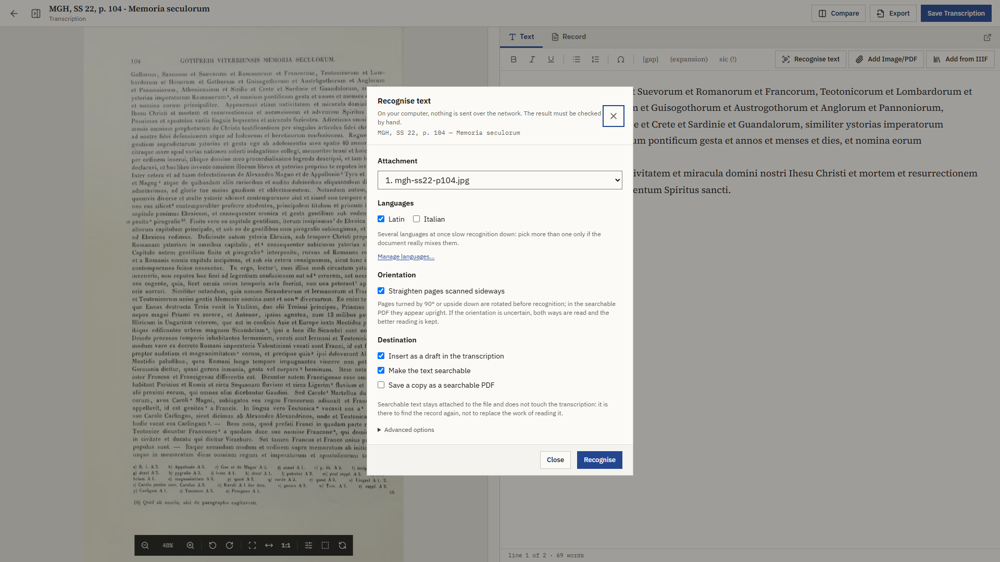
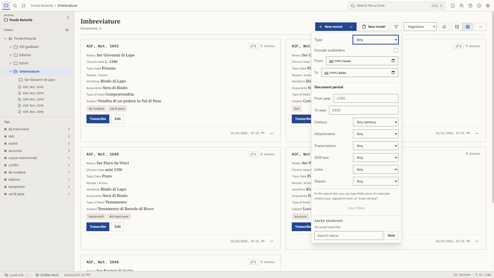
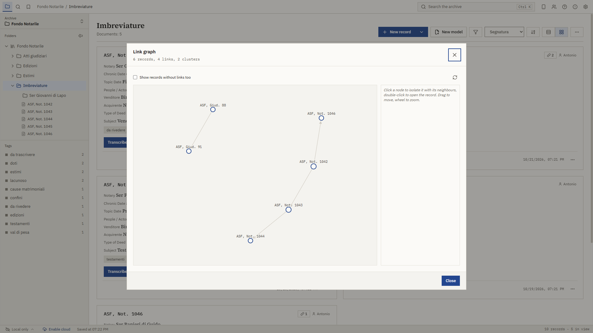
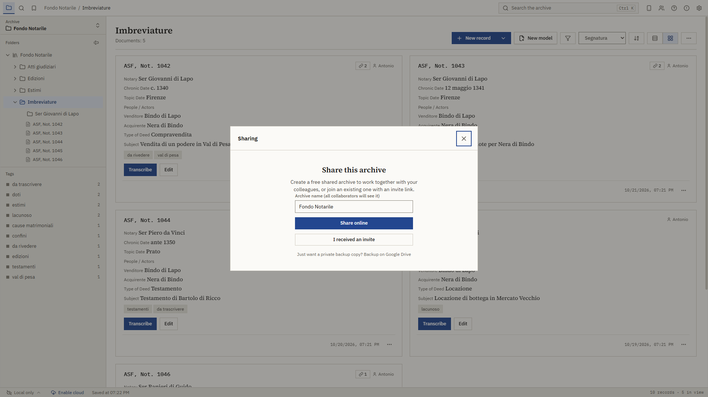
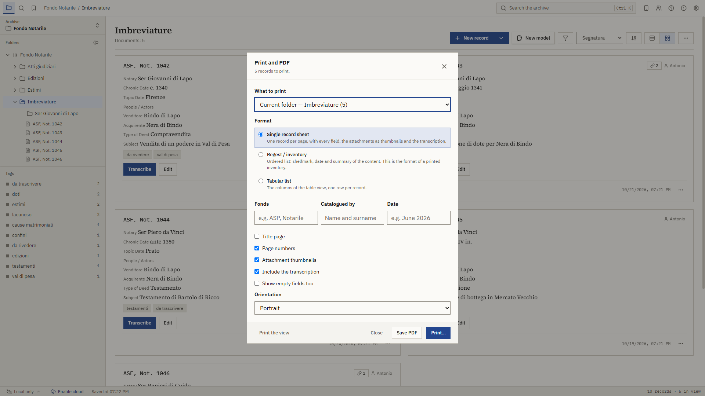

_Read this in [Italian](README-it.md)_

<picture>
  <source media="(prefers-color-scheme: dark)" srcset="docs/screenshots/en/vista-tabella-dark.png">
  
</picture>

# ArchiView

[](https://github.com/AntonioOrf/ArchiView/releases/latest)
[](https://github.com/AntonioOrf/ArchiView/releases?q=scanner-v&expanded=true)

**ArchiView** is a desktop application (built with Electron) for cataloguing, archiving and transcribing manuscripts and historical documents. It works offline.

## Transcription

<picture>
  <source media="(prefers-color-scheme: dark)" srcset="docs/screenshots/en/trascrizione-dark.png">
  
</picture>

The transcription editor sits next to the original images or PDF of the document, with one transcription per folio or PDF page.

## Document models

<picture>
  <source media="(prefers-color-scheme: dark)" srcset="docs/screenshots/en/form-scheda-dark.png">
  
</picture>

Each record follows a document model that decides which fields the form shows. ArchiView ships with three models (Notarial imbreviatures, Judicial acts, Tax documents), and you can build your own from the fields you need (title, authors, shelfmark, medium and so on). A single record can also carry extra fields its model does not have.

## Text recognition (OCR)

<picture>
  <source media="(prefers-color-scheme: dark)" srcset="docs/screenshots/en/ocr-dark.png">
  
</picture>

Recognise the text of scans and PDFs entirely offline, with language packs you install only when needed. The result can go into the transcription as a draft, or stay attached to the file as searchable text so you can find the record later. Recognition can also save a copy of the attachment as a **searchable PDF**, and pages scanned sideways or upside down are straightened automatically.

## Search, filters and tags

<picture>
  <source media="(prefers-color-scheme: dark)" srcset="docs/screenshots/en/filtri-dark.png">
  
</picture>

Filter the archive by document type, historical date range or century, and by whether a record has attachments, a transcription, OCR text or links. The search box accepts `field:value` queries (for example `notaio:rossi`, `tag:parchment`) and exact phrases, and searches can be saved. Tags live in their own sidebar panel with a count for each tag.

## Linked records and graph

<picture>
  <source media="(prefers-color-scheme: dark)" srcset="docs/screenshots/en/grafo-dark.png">
  
</picture>

Connect records to one another with typed links (a related deed, a copy of, and so on). Each record lists the records it points to and the ones that refer to it. The link graph gives an overview of the whole archive: click a node to isolate it with its neighbours, and double-click it to open the record.

## Shared archives

<picture>
  <source media="(prefers-color-scheme: dark)" srcset="docs/screenshots/en/condivisione-dark.png">
  
</picture>

Create a free shared archive and invite colleagues with a link. Records, transcriptions and the archive name are encrypted before they leave your computer, so the server cannot read them. Other members are notified as soon as someone sends changes. When two people change the same field, ArchiView shows both versions and lets you choose; changes to different fields merge on their own. If you only want a private backup, you can back the archive up to Google Drive instead.

## Print and export

<picture>
  <source media="(prefers-color-scheme: dark)" srcset="docs/screenshots/en/stampa-dark.png">
  
</picture>

Print a record, a folder or the whole archive, or save it as a PDF, in one of three layouts: a full record sheet with thumbnails and transcription, a regest/inventory like a printed finding aid, or a tabular list, with an optional title page. Transcriptions can be exported as HTML, Markdown or RTF (for Word and LibreOffice), and citations as BibTeX for LaTeX, Zotero and JabRef.

## Other features

- Import digitised manuscripts from any library that publishes IIIF manifests (Presentation v2 and v3), such as BnF/Gallica, e-codices, the Vatican Library, the British Library and the Bodleian. Folios are streamed from the library and cached locally, and you can download them into the archive for OCR or offline work.
- Organise records in folders and subfolders, and keep unrelated projects in separate archives.
- Attach scans, photographs and PDFs to a record and view them inside the app, with zoom, rotation, brightness, contrast and negative.
- Learn the app from the built-in guided tour. The interface is available in English and Italian.
- Your data stays in your working folder as a JSON file plus a folder of attachments, readable outside the app. Copying that folder moves or backs up the whole archive, and the app can also pack the archive and its attachments into a single ZIP.

## Download and installation

ArchiView currently runs on Windows only.

1. Go to the [Releases](https://github.com/AntonioOrf/Schedatore/releases) page of the project on GitHub.
2. Download the `.exe` file of the latest release.
3. Run the downloaded file.

## User guide (wiki)

The user guide covers installation, the interface, records, transcription, search, sync and sharing, export and print, and has a FAQ. Read it in the **[ArchiView Wiki](https://archiview.orfhist.com/wiki/en/)** (also in [Italian](https://archiview.orfhist.com/wiki/)).

---

## For developers (building from source)

To run the application from source you need [Node.js](https://nodejs.org/):

1. Clone this repository or extract the project files.
2. Open the terminal in the root directory (where the `package.json` file is located).
3. Install the dependencies:
   ```bash
   npm install
   ```
4. Start the application:
   ```bash
   npm start
   ```

### Building the installer

```bash
npm run pack
```

`electron-builder` writes the Windows installer to the `dist` folder.

## First launch

On first launch ArchiView asks you to choose a **working folder**. Pick an empty folder you will not delete by mistake. The app creates inside it:

- `database_manoscritti.json`, with all records, transcriptions and metadata;
- `allegati_manoscritti`, where the images and PDFs you attach are copied.

You can change the working folder later from **Settings**.

## Technologies used

- [Electron](https://www.electronjs.org/) for the desktop framework.
- [Tailwind CSS](https://tailwindcss.com/) for UI styling.
- [Lucide Icons](https://lucide.dev/) for icons.

## Legal & Privacy

- [Privacy Policy](PRIVACY_POLICY.md)
- [Terms of Service](TERMS_OF_SERVICE.md)

## License

See the [LICENSE](LICENSE) file for more information on the terms of use.
